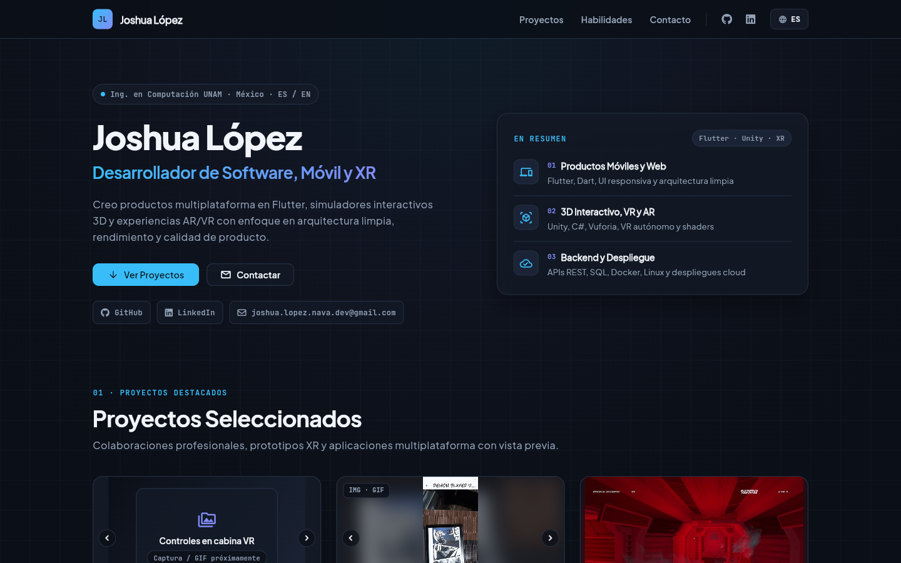

# Personal Portfolio

Bilingual (EN/ES) single-page developer portfolio built with Flutter and deployed as a web application on Cloudflare Workers.

**Live site:** https://portfolio.joshua-lopez-nava-dev.workers.dev/

---

## Preview



## Overview

This repository contains the source code for Joshua López's personal portfolio. It presents featured software, mobile, game development, and XR projects alongside technical skills and contact information in a responsive single-page layout that adapts across desktop, tablet, and mobile viewports.

## Features

- **Responsive single-page layout:** Smooth section navigation across hero, projects, skills, and contact sections with a mobile drawer menu.
- **Internationalization (EN / ES):** Runtime language switcher powered by `flutter_localizations` and ARB resource files.
- **Interactive project previews:** Project cards support static screenshots, animated GIFs, multi-item carousels, labeled media placeholders for NDA/non-code showcases, expandable lightbox viewing (`InteractiveViewer`), and embedded YouTube video dialogs.
- **Clean layered structure:** Separates domain entities, repositories, use cases, local data sources, and presentation widgets by feature (`profile`, `projects`, `skills`).

## Tech Stack

| Component | Technology |
| --- | --- |
| Framework | Flutter / Dart |
| Localization | `flutter_localizations`, `intl` |
| Typography & Icons | `google_fonts`, `font_awesome_flutter` |
| Media & Links | `youtube_player_iframe`, `url_launcher` |
| UI Animation | `animated_text_kit` |
| Hosting | Cloudflare Workers (Web build) |

## Project Structure

```text
.
├── assets/
│   ├── icons/                      # App launcher icon assets
│   └── images/projects/            # Project screenshots and GIF previews
├── lib/
│   ├── features/
│   │   ├── profile/                # Profile entity, repository, use case, local data source
│   │   ├── projects/               # Project & ProjectMedia entities, data source (EN/ES)
│   │   └── skills/                 # Skill entity and local data source
│   ├── l10n/                       # ARB files (app_en.arb, app_es.arb) and generated localizations
│   ├── presentation/
│   │   ├── screens/                # HomeScreen layout and responsive sections
│   │   └── widgets/                # NavBar, HeroSection, ProjectCard, SkillsSection
│   ├── theme/                      # AppTheme colors and typography
│   ├── injection_container.dart    # Lightweight dependency wiring
│   └── main.dart                   # Application entry point and locale state
├── test/                           # Widget tests
├── l10n.yaml                       # Localization generation config
└── pubspec.yaml
```

## Getting Started

### Prerequisites

- Flutter SDK (Dart SDK `^3.10.7`)

### Run Locally

```bash
git clone https://github.com/JoshuaLopez2000/Portfolio.git
cd Portfolio
flutter pub get
flutter run -d chrome
```

### Validation & Production Web Build

```bash
flutter analyze
flutter test
flutter build web
```

The compiled web bundle is output to `build/web`.

## Customizing Content

Portfolio content is maintained in local data sources and asset folders:

- **Profile:** `lib/features/profile/data/datasources/profile_local_data_source.dart`
- **Projects & Media:** `lib/features/projects/data/datasources/project_local_data_source.dart`
  - Add screenshots or GIFs under `assets/images/projects/` and reference them via `previewImage` or `previewMedia` (`ProjectMedia`).
  - Leave `ProjectMedia.assetOrUrl` as `null` to render a labeled placeholder slot until captures are ready.
- **Skills:** `lib/features/skills/data/datasources/skill_local_data_source.dart`
- **Localization:** Edit `lib/l10n/app_en.arb` and `lib/l10n/app_es.arb`, then regenerate localization classes with:

```bash
flutter gen-l10n
```
